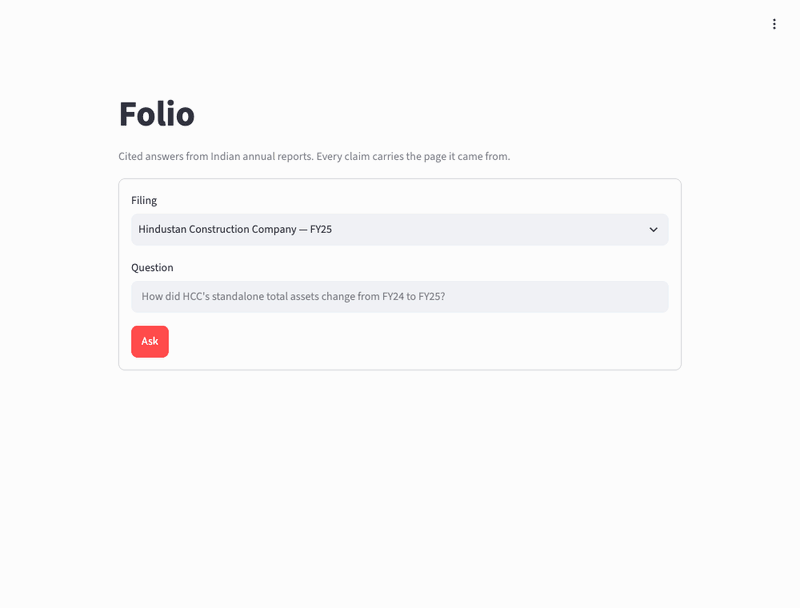
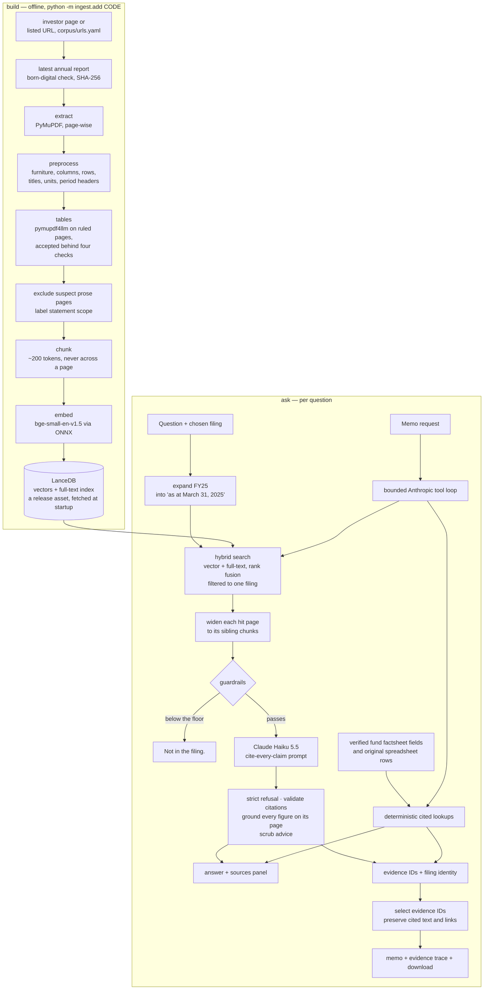

# Folio

*folio: a numbered page of a book or filing. Every claim carries the folio it came from.*

Read public mutual-fund disclosures and ask questions about Indian annual
reports. **Every reported fact links to its source page or spreadsheet row**,
or the answer is *"Not in the filing."*

**Live demo: [folio-india.streamlit.app](https://folio-india.streamlit.app)** · ten annual-report questions per visit



The Funds reader covers Kotak Manufacture in India, HDFC Defence, and Motilal
Oswal Nifty 500 Index Fund. Their complete September 2026 portfolios contain
588 instrument rows; the top ten domestic equities from each form a union of
28 companies. These FY26 reports join the four existing filings.

Choose **Funds** for costs, benchmark, exit load, holdings and report drill-down,
or **Companies** for annual-report Q&A. Coverage is per fund: a company outside
one fund’s top ten remains **Not indexed** there, even if another fund includes it.

The **Memo** mode assembles up to 450 words of cited evidence for a
company or public fund snapshot. One plain Anthropic tool loop asks the existing
readers for facts, then selects evidence IDs; Python retains their original text
and source links. The interface includes an evidence trace and Markdown download.
Agent release checks are tracked in [notes/agent-step.md](notes/agent-step.md).

## Why

Aggregate financial data is a solved problem. Checking a number is not. A
figure lifted out of an annual report is useless for research unless you also
know three things the page knows and a chatbot usually loses:

- **Which page it came from**, so it can be verified in seconds.
- **Its unit.** "2,28,299" means nothing until the page says *₹ in Lakhs* — and
  reports use crore, lakh, million and thousand units.
- **Its scope.** Standalone and consolidated statements repeat the same row
  labels with different numbers, eighty pages apart.

Folio preserves these labels through retrieval and shows the evidence beside the answer.
Ambiguous scope remains explicitly unstated; figure-grounding warnings remain visible.

## Architecture



## How a question becomes a cited answer

1. **Pick the filing.** Page numbers repeat across reports — many have a
   page 114 — so every query is filtered to one company. Comparing companies is
   a later feature, not something search should do by accident.
2. **Expand the fiscal year.** Questions say "FY25"; statements say "As at
   March 31, 2025". The words never meet, so the period-end date is appended
   by rule, never by a model call.
3. **Search twice and fuse.** A vector ranking finds wording; a full-text
   ranking finds labels like `TOTAL ASSETS`. Reciprocal rank fusion merges the
   two orderings without pretending their scores are comparable.
4. **Widen each hit page.** The figure asked about often sits a chunk or two
   from the wording that matched, and a sibling chunk is the same citable page,
   so pages near the top of the ranking are filled in to a token budget.
5. **Answer from the extracts only.** Each extract is labelled with the page
   from its chunk record, and the model may cite only those labels — never a
   number read out of the page, where note references and years look exactly
   like page numbers.
6. **Check what came back**, then render the answer beside every chunk the
   model read.

Chunks carry their own context: a chunk from the middle of a balance sheet
inherits that page's statement title, unit declaration and period header, so it
still knows it is the *standalone* balance sheet, reported in *₹ crore*, *as at
March 31, 2025*.

## Guardrails

No single check keeps a citation honest, so there are six.

| Check | When | What it stops |
|---|---|---|
| Similarity floor (0.67) | before the model is called | a question nothing in the filing resembles, caught before a paid call. A pre-filter only — see Limitations |
| Refusal contract in the prompt | during the call | a hedged half-answer built from plausible but unhelpful extracts |
| Strict refusal | after the call | "Not in the filing." followed by anything: the rest is cut, so a refusal is always one sentence |
| Citation validation | after the call | a page the model was never shown; an answer whose citations were all invented, or which carried none, is withheld entirely |
| Figure grounding | after the call | a figure that is not printed on the page it cites. If exactly one page the model was shown prints all of a claim's figures, the citation is moved there and the reader is told; otherwise the figure is flagged. A computed figure must say "(computed from [page N])" |
| Advice scrub | after the call | investment advice, which this project never produces |

Every `[page N]` in an answer links to the issuer's PDF opened at that page.

## The corpus, and a worked example

Annual reports are listed with their exact download URL and SHA-256 in
[`corpus/SOURCES.md`](corpus/SOURCES.md); `corpus/corpus.json` carries the same
in machine-readable form, and the build verifies every checksum before
indexing. The PDFs themselves are not committed.

**The lakhs-versus-crore trap.** Navneet Education's standalone balance sheet
prints:

```
STANDALONE BALANCE SHEET
AS AT 31st MARCH, 2025
(₹ in Lakhs)
Particulars | Notes | As at 31st March, 2025 | As at 31st March, 2024
...
TOTAL ASSETS | 2,28,299 | 1,74,089
```

Many other filings report in crore. Read "2,28,299" with the wrong unit and
the answer is wrong by a factor of a hundred, while still citing the correct
page. So the unit line is treated as load-bearing throughout: it is never
stripped as repeated page furniture, it is carried into every chunk of its
page, and the prompt forbids naming a unit the extract does not state — an
answer must say the page gives no unit rather than assume one.

## Run locally

```bash
git clone https://github.com/shivank2703/folio.git && cd folio
python3 -m venv .venv && .venv/bin/python -m pip install -r requirements.txt
.venv/bin/streamlit run streamlit_app.py
```

Python 3.13. Nothing is built to try it: on first start the app downloads the
search index named in `corpus/index.json` (a release asset; its exact size is recorded in that pointer) and checks
its SHA-256. **No API key is needed** for retrieval, the sources panel or the
refusal path — only for generating prose answers. To add a key, copy
`.streamlit/secrets.toml.example` to `.streamlit/secrets.toml`, or put
`ANTHROPIC_API_KEY=` in a `.env` file.

Rebuilding everything from source, after downloading the PDFs named in
`corpus/SOURCES.md` into `corpus/`: `.venv/bin/python -m ingest.build`.
Retrieval alone, with no key and no UI: `.venv/bin/python -m retrieve.smoke`.
The answer-quality eval (spends API credit, about $0.50 a run):
`.venv/bin/python -m evals.score --label mine`.

Create a memo from the command line (also spends API credit):

```bash
.venv/bin/python -m agent.run --company HCC 'Prepare a factual memo on the business and standalone financial position in FY25.'
.venv/bin/python -m agent.run --fund hdfc-defence 'State the Direct-plan expense ratio, benchmark and three largest domestic equity holdings.'
.venv/bin/python -m evals.agent --label my-agent-check
```

The loop allows six turns, eight tool calls and twelve API calls per memo.
Every call counts toward the public daily allowance, including nested report
answers. The ten-request session cap is shared with annual-report Q&A. Repeated
tool requests reuse evidence; downloading a memo does not regenerate it.
Memos may omit unavailable evidence. A source link and numeric checks do not
prove every prose claim; the evaluation separately judges source faithfulness.
See the [implementation write-up](docs/agent-writeup.md) and
[local UI walkthrough](docs/agent-demo.mp4).

## Refresh a public fund snapshot

Download the exact official files referenced in `corpus/funds-sources.json`
into the ignored `data/funds/` paths named there. Inspect the original cells
and rendered factsheet pages, update the source hashes, row ranges, dates and
reviewed company mappings, then run:

```bash
.venv/bin/python -m funds.build
.venv/bin/python -m unittest discover -s tests
.venv/bin/python -m evals.funds --output evals/results/my-fund-checks.json
.venv/bin/python -m evals.score --label my-fund-reports --questions evals/funds-reports.jsonl
```

The builder verifies checksums, sheet identity, headers and the disclosed total.
It reads cached spreadsheet cells without executing formulas. Every disclosed
instrument remains in the table; only ten domestic equities per fund are eligible
for annual-report Q&A. Negative net-current-asset rows and tiny weight bounds
are retained. Factsheet fields are reviewed transcriptions, not generated text.
Use a new result filename on every evaluation; existing results are preserved.

## Add a company

One offline command finds a listed company's latest annual report, downloads
it, checks it, and indexes it — that filing only, not the whole corpus:

```bash
.venv/bin/python -m ingest.add UNIHEALTH          # one company
.venv/bin/python -m ingest.add UNIHEALTH HCC      # several
.venv/bin/python -m ingest.add HCC --verify       # re-download, compare SHA-256, change nothing
.venv/bin/python -m ingest.publish                # upload the index; commit corpus/index.json
```

**From the app (maintainer only).** Open the live app once with
`?owner=<FOLIO_OWNER_KEY>` (or run it locally) and an **Add a company** panel
appears above the question box: give a code, a name and the company's
investor-relations page or a report PDF URL. It runs the same command in the
background (3–10 minutes, progress shown), uploads the new index and commits
the record files to GitHub, which redeploys the app with the company in the
Filing list. Visitors never see the panel. It needs `GITHUB_TOKEN` in the
app's secrets: a fine-grained GitHub token for this repository only, with
"Contents: Read and write" and nothing else.

A company is one entry in [`corpus/urls.yaml`](corpus/urls.yaml): its investor
page, report URLs kept by hand, or both. The command reads every PDF the page
links, works out each report's fiscal year from its link text or its own first
pages, and takes the latest. It refuses a report whose pages are more than 20%
images with no text (there is no OCR path), records the URL and SHA-256 in
`corpus.json` and `SOURCES.md`, and replaces only that company's rows in the
index. Run it again and nothing changes.

Where reports can come from, checked with plain, self-identifying requests
that respect robots.txt and wait between calls:

| Source | Find reports | Download a report |
|---|---|---|
| Company investor-relations pages | yes | yes |
| NSE file archive (archives.nseindia.com) | no — no listing to read | yes, from a URL in `urls.yaml` |
| NSE website and annual-report API | no — scripted requests are reset | — |
| BSE | no — its API answers "Access Denied" | — |

Folio does not imitate a browser to get past a site that refuses scripts; a
blocked company's report URL goes in `urls.yaml` by hand.

## Measured

Answer quality on 24 questions — 18 answerable (lookups, tables from the pages
extraction handles worst, a two-column page, a two-page spread, a computed
figure, a multi-hop, lakhs-vs-crore traps) and 6 not in the filing — each
answered three times through the app's own path
([evals/RESULTS.md](evals/RESULTS.md)). Correctness is judged by Haiku 4.5
without the pages; faithfulness by a second Haiku call without the reference
answer.

| | v1.0 | v1.1 | v1.2 on Haiku 4.5 (all 24) | **v1.2 on Haiku 5.5 (all 24)** |
|---|---|---|---|---|
| Answerable questions passed | 34/45 | 43/45 | 48/54 | **47/54 (87%)** |
| Correct figure, unit, period and scope | 42/45 | 45/45 | 50/54 | **51/54** |
| Every claim supported by the cited page | 34/45 | 44/45 | 50/54 | **51/54** |
| Not in the filing: bare refusal | 13/15 | 15/15 | 18/18 | **18/18** |

v1.0 and v1.1 were measured on the first 20 questions; v1.2 on all 24.

Funds comparison, measured 19 October on the same 24 questions × three samples.
The saved pre-change run is preserved; the historical release table above is a
separate run, not the before score for this step.

| Measure | Saved v1.2 baseline | Funds candidate |
|---|---|---|
| Answerable passed | 44/54 (81%) | 53/54 (98%) |
| Correct | 51/54 (94%) | 54/54 (100%) |
| Faithful | 49/54 (91%) | 53/54 (98%) |
| Bare refusals | 18/18 | 18/18 |

The new annual-report set scored 12/12 correct and 11/12 faithful; the
24 deterministic fund disclosure/coverage cases and 18 local tests passed.
Both faithfulness disagreements remain in the automated scores; details and
intermediate runs are in [evals/RESULTS.md](evals/RESULTS.md).

The expanded index contains **32 filings, 56,112 chunks**, 11,601 source PDF
pages and 10,015 included pages. It records 1,299 quality exclusions; 1,974
included pages use the ruled-table reader. Retrieval finds an expected page
in the top five for 17/18 questions and exact answer text in context for 16/18.


v1.1 labelled computed figures, cut refusals to one sentence, checked every
figure against its cited page, and re-read ruled tables with pymupdf4llm; a
cross-encoder reranker was tried and **not shipped** (it lost answers on
held-out questions). v1.2 added Unihealth through `ingest.add`, which exposed
three bugs fixed for every filing: two-page spreads fused tables, re-read table
pages dropped their year headers, and the prompt never said whose report it
was. It also moved generation from Claude Haiku 4.5 to Claude Haiku 5.5, about
a sixth of the cost per question: at first 5.5 answered 9 fewer questions,
because it follows the prompt's rules more literally (it will not call a figure
consolidated when the page does not say so) and added material nobody asked
for; three prompt rules and one guard fix brought it level, and its answers
are now more often correct and faithful than 4.5's (evals/RESULTS.md).

| | |
|---|---|
| v1.2 corpus (historical) | 4 filings, 1,028 pages → 6,040 chunks, index 10.1 MB as a release asset; 248 pages' tables read by pymupdf4llm |
| v1.2 full rebuild | ~12.5 min; adding one company with `ingest.add` ~3–4 min |
| v1.2 retrieval, 24 questions | 14/18 expected pages in the top 5; 15/18 answer text inside the context |
| v1.2 warm retrieval | ~21 ms search, ~10 ms page expansion |
| v1.2 live answer time | ~3.3 s on average for a cited answer (9.7 s worst, Haiku 5.5 thinks first), ~0.1 s for a refusal at the floor |
| v1.2 cost per answered question | $0.0012 on average on Haiku 5.5 (was ~$0.008 on Haiku 4.5) |

Agent candidate, measured locally on 25 October: the same company set scored
71/72 overall (53/54 answerable and 18/18 strict refusals), against a fresh
72/72 ordinary-Q&A baseline. The 12-case routing suite passed 36/36, and the
general company-memo check passed 2/3. Both final failures are retained judge
disagreements about computed figures; these results are not manually corrected.
All 34 local tests and 24 deterministic fund regression cases passed.
See [Agent results](evals/RESULTS.md#agent--25-october-2026--local-candidate).

## Limitations

Stated plainly, because overclaiming is the failure this project is built
against:

- **The similarity floor does not separate answerable questions from
  unanswerable ones**, measured: the weakest answerable question scores
  0.702 and the strongest not-in-filing one 0.757 in the final Funds smoke
  check. It stays as a cheap pre-filter for gross mismatches; refusal rests
  on the prompt contract plus the strict-refusal cut, which refused all 18
  not-in-filing samples in the final evaluation. A cross-encoder gate was
  tried and lost answers on held-out questions.
  A live BEL query phrased “at March 31, 2026” scored 0.663 and was refused
  despite retrieving the balance sheet; the equivalent “at the end of FY26”
  query passed and returned the cited total. Wording can cause false refusals.
- **Six not-in-filing questions are too few to fit a refusal threshold.**
  That is part of why the reranker's threshold did not hold; the eval needs
  more negatives before the next attempt.
- **The expansion width was tuned on the same nine questions.** Eight seed
  chunks and a 6,000-token budget is the smallest setting that put every
  answer in front of the model on this set; it is a fitted number, not a
  derived one.
- **Adding filings shifts retrieval for the ones already there.** Full-text
  scores use collection-wide word statistics, so a third report moved one
  page's rank even though queries are filtered to one company. The wider
  expansion absorbs that today; more documents may not be so forgiving.
- **One fiscal year per company, one filing per report-tool call.** A fund
  memo may gather separate cited answers from its top-ten companies. Multi-year
  ingest and aggregate company comparisons are not built.
- **Scope follows explicit financial headings.** Every chunk carries standalone,
  consolidated, mixed, or unstated. Repeated note headings count; the pipeline
  does not infer a missing heading from a nearby section. A requested scope
  excludes the opposite explicit scope but retains ambiguous pages.
- **Some pages are deliberately excluded.** Visual QA and a conservative prose
  check remove suspect interleaved columns. This may also omit legitimate
  narrative tables. It reduces coverage; it does not repair their layout.
  Excluded viewer pages and reasons are recorded in the corpus manifest.
- **Fund dates are independent.** All portfolios are dated 30 September 2026.
  Kotak and HDFC factsheets share that date; Motilal's product page still linked
  an August 2026 factsheet when checked on 18 October. The reader labels both
  dates and refuses incompatible dated lookups. It is a verified snapshot,
  not a live feed. Kotak/HDFC disclose base expense ratios including specified
  levies; Motilal discloses total TER and a separate base ratio. These labels
  are preserved rather than presented as directly interchangeable costs.
- **Tables are read well only where they are ruled.** pymupdf4llm reads
  gridded notes exactly (ageing schedules, borrowings, cash flow), but merges
  whole columns on shaded statements and fails on rotated ones, so it is
  accepted page by page behind four checks, while other pages retain the
  geometry-based reading or are excluded by the quality check. Statements of changes in equity and sustainability
  grids remain the weakest pages.
- **The embedding model is a quantized export**, so published benchmark scores
  describe slightly different weights.
- **Ten whole rows exceed the embedding model’s 512-token input limit.**
  Their vectors are truncated; full text remains available to keyword search
  and the answer context. Decorative dotted leaders have been removed before
  embedding. This is a retrieval limitation on those rows, not a claim that
  every page has been exhaustively validated.
- **The judge is a model.** Read by hand, it made three mistakes in the
  runs above (it called "(146.98)" bad arithmetic, and "5.8 km" computed when
  the page prints it). It was kept frozen across the step so that every run is
  graded the same way; disagreements are listed in evals/RESULTS.md.
- **The demo is rate-limited, for visitors only.** Ten questions per browser
  session, 25 model calls per connection per day, 500 across everyone
  per day, resetting at midnight UTC. Memos consume multiple calls. Questions refused at the
  similarity floor are free and never count. Counts live in the server
  process, so a restart resets them, and an address can be spoofed: this is
  fair use, not security, and the monthly spend limit on the API key is the
  hard ceiling. Local runs and the maintainer's keyed session are exempt.
- **Finding reports needs a cooperative website.** NSE's site and API and
  BSE's API refuse scripted requests, so reports are found on company
  investor pages or listed by hand; a company whose page blocks scripts needs
  its URL added to `corpus/urls.yaml`. One filing per company, the latest.
- **New report layouts need a look.** Two-page spreads are now read as two
  pages, but a spread pairing two different documents (an auditor's annexure
  beside a balance sheet) gets no statement title, and a scanned report is
  refused outright (no OCR).
- **Not advice.** The system reports what a filing says. It produces no
  recommendations and strips advice language if a model drifts into it.

## Roadmap

One step per Saturday ([SPEC.md §4](SPEC.md)):

- **Public** (03 Oct 2026, v1.0): cited Q&A over three annual reports, deployed.
- **Accurate** (04 Oct 2026, v1.1): a 20-question eval with a
  Haiku judge; figure-level citation checks; labelled computed figures; strict
  refusals; ruled tables via pymupdf4llm. Reranker measured and not shipped.
- **Ingest** (04–11 Oct 2026, v1.2): `ingest.add` finds, verifies
  and indexes a listed company's latest annual report; the index moved out of
  git to a release asset; the public demo got per-visitor and daily limits.
- **Funds** (17–19 Oct, v1.3 candidate): three public fund snapshots, full
  holdings tables, source-row citations, top-ten annual-report drill-down,
  explicit statement scope and improved page-continuation packing.
- **Agent** (25 Oct, deployed): one bounded Anthropic tool-use loop over
  company and fund readers; a memo of up to 450 words, every sentence cited,
  evidence trace and Markdown download. Release evidence is in the Agent notes.

Cut: RAGAS in CI, LangGraph, Langfuse. Later, maybe: trend charts, multi-year
ingest, daily exchange-disclosure flags.

## Data and licence

The source PDFs are public statutory filings and are **not** committed;
`corpus/SOURCES.md` records each exact URL and SHA-256. The derived chunk index
is published as an asset on this repository's `index` release (it was committed
until v1.1) and fetched by the app at startup, with attribution to each issuing
company and a link to its source document.

`corpus/funds.json` is a normalized snapshot of public scheme disclosures,
with source URLs, SHA-256 hashes, PDF pages and original spreadsheet row numbers.
The original PDFs and spreadsheets stay out of git. No personal portfolios,
folios or invested amounts are included.

Licensed under [AGPL-3.0](LICENSE), matching PyMuPDF's terms for a
network-served application.
